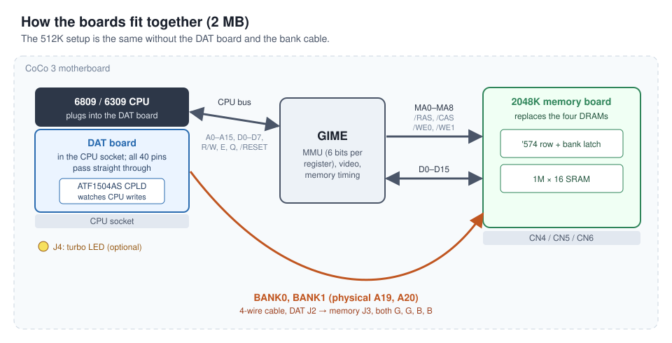
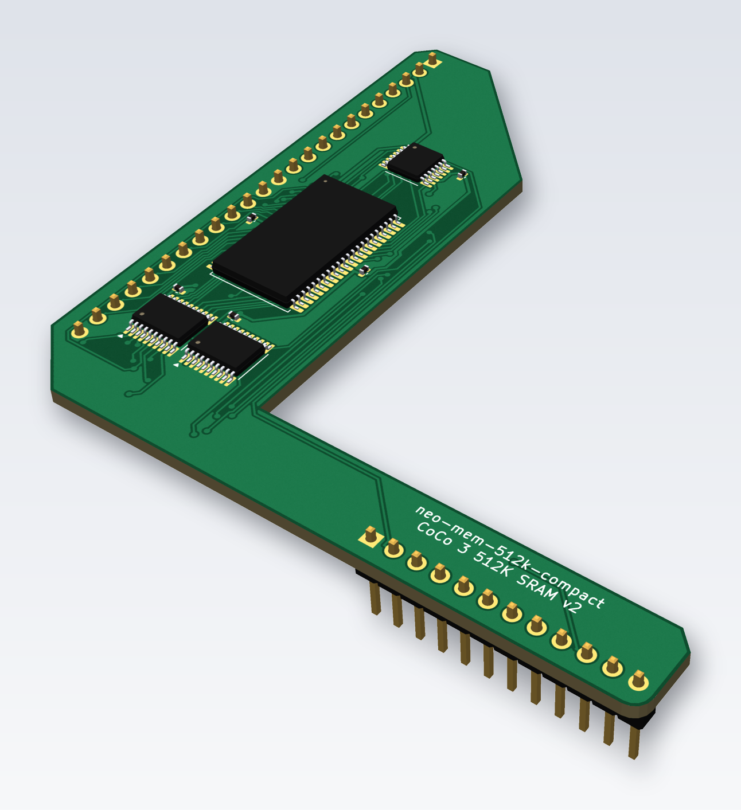
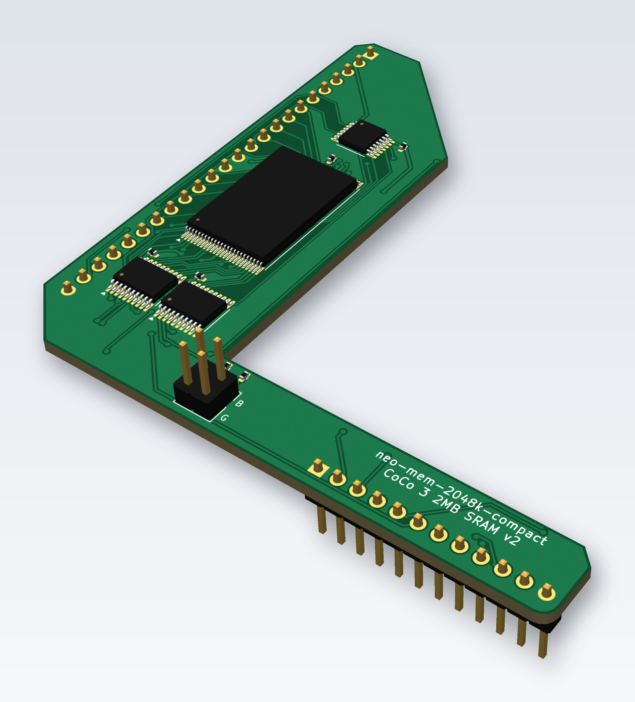
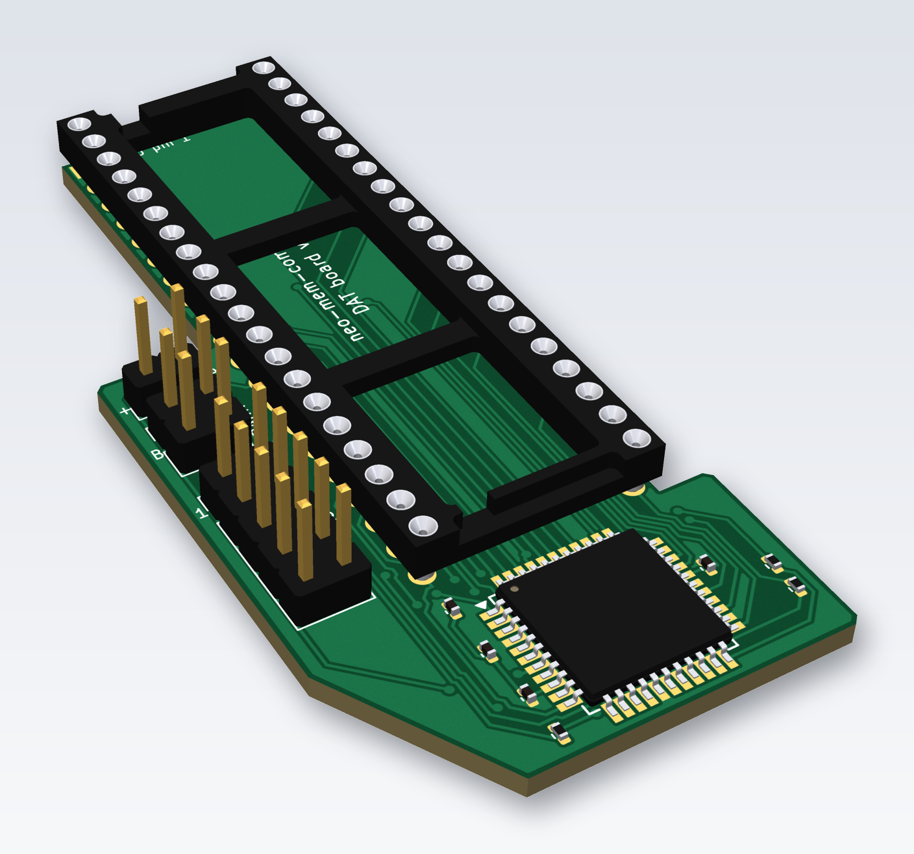
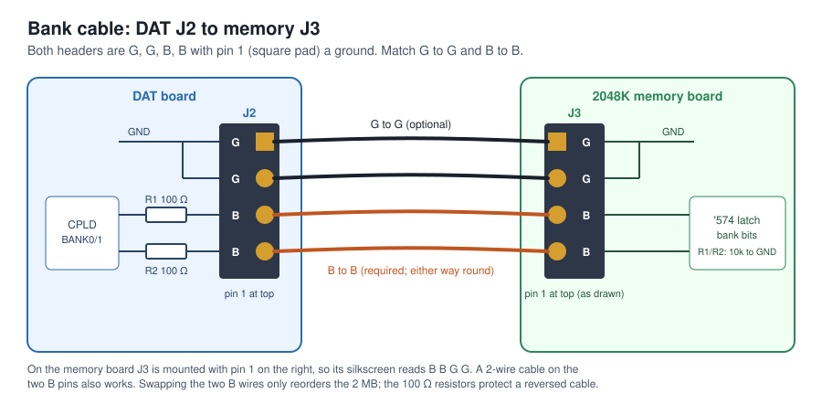
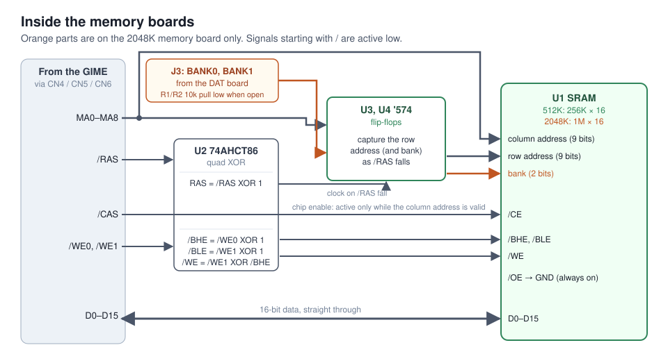
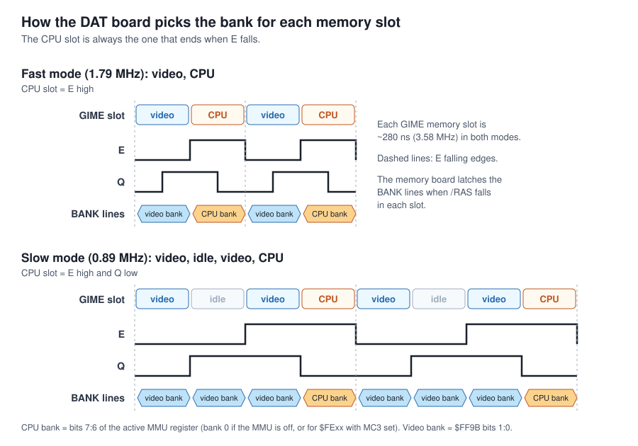

# neo-mem-compact

> ⚠️ **UNTESTED DESIGN.** None of these boards has been built or tried in a CoCo 3.
> They have only been checked on paper: design-rule checks, an independent pin-by-pin
> check against datasheets, and simulation of the DAT board's logic. Real hardware may
> still show timing or fit problems these checks can't catch. Build them at your own
> risk, order the smallest quantity you can, and treat a first batch as prototypes.

Compact surface-mount RAM expansions for the Tandy Color Computer 3. They plug into
the CN4/CN5/CN6 expansion sockets (and, for 2 MB, the CPU socket).

| Board | What it does | Main parts |
|---|---|---|
| [**512K memory**](boards/512k) | 512K upgrade on its own | CY62146ESL 256K×16 SRAM, 74AHCT86, 2× 74x574 |
| [**2048K memory**](boards/2048k-mem) | 2 MB of RAM; runs as 512K on its own | CY62167ELL 1M×16 SRAM, 74AHCT86, 2× 74x574 |
| [**DAT**](boards/dat) | Sits under the CPU and supplies the extra address bits the 2048K memory board needs; also drives an optional turbo LED | ATF1504AS CPLD |

**Which to build:**
* **512K:** the 512K memory board. It's the cheapest option.
* **2 MB:** the 2048K memory board plus the DAT board, joined by a short bank cable
  (both headers are 2×2, laid out like the GIME-Z's bank header).
  The memory board also runs alone as 512K, so you can fit it first and add the DAT
  board later.



| 512K memory | 2048K memory | DAT |
|---|---|---|
|  |  |  |
| [layout](boards/512k/docs/preview.png) | [layout](boards/2048k-mem/docs/preview.png) | [layout](boards/dat/docs/preview.png) · [with CPU fitted](boards/dat/docs/render-cpu.png) |

*3D renders of the assembled boards, made from the real PCB layers and KiCad's
standard part models (the DAT board's wire-wrap socket is drawn as a normal socket).
The "layout" links show the flat top and bottom views.*

**Status: untested - no board has been built yet.** What *has* been checked: all
three boards pass DRC, and each finished PCB was checked independently against
datasheet pinouts (`boards/*/docs/`). The DAT board's CPLD logic passes a cycle-level
simulation in both CPU speed modes, both as written and after fitting into the chip.
Not yet confirmed on real hardware: memory timing on a real GIME (and on faster GIME
replacements), the DAT board's bank timing against /RAS, and physical fit in the case.
The DAT board's outline was fitted to an Athena-style board's layout and measured
parts heights (see [Fitting](#fitting)), not to a real machine.

## Connectors, jumpers and features

### 512K memory board
| Ref | What | Use |
|---|---|---|
| J1 | 24-pin header, **underneath** | Plugs into CN6/CN5 (the vertical socket pair left of the RAM). Pin 1 (square pad) faces the rear ports. |
| J2 | 12-pin header, **underneath** | Plugs into CN4 (the horizontal socket above the keyboard connector). Pin 1 at the left end. |

No jumpers or settings.

### 2048K memory board
| Ref | What | Use |
|---|---|---|
| J1, J2 | Same as the 512K memory board | Same fitting. |
| J3 | 2×2 header on top: a **B** row and a **G** row | Bank input from the DAT board (or any source with the same layout as the GIME-Z bank header). Pin 1 is the square pad, a B pin. |



* **J3 left open:** runs as 512K (R1/R2 hold the bank lines low).
* **2×2 cable (pin 1 to pin 1):** B to B, G to G. The two B wires can go either way
  round; swapping them only reorders memory.
* **Two single leads:** only the two B pins are needed; the motherboard provides the ground.

### DAT board
| Ref | What | Use |
|---|---|---|
| J1 | 40-pin wire-wrap socket | Sits in the CPU socket, and the 6809/6309 plugs into it. Pin 1 is the square pad, marked "CPU pin 1". |
| J2 | 2×2 header: a **B** column (board edge) and a **G** column | Bank output to memory J3. Pin 1 is the square pad, a B pin. Both B lines have 100 Ω protection (R1/R2), so a plug turned round does no harm. |
| J3 | 2×5 JTAG header | Programs the CPLD with `dat2m_top.jed`. Atmel ATDH1150USB / USB-Blaster layout (1 TCK, 2 GND, 3 TDO, 4 +5V, 5 TMS, 9 TDI, 10 GND). The CoCo must be powered on while programming. |
| J4 | 1×2 turbo LED header | Pin 1 "+" (+5V) to the LED's anode, pin 2 to its cathode. The 470 Ω resistor (R3) is on the board, so connect the LED directly. |
| JP1 | 3-pad solder jumper, **on the back** | Mode select, marked "512K JP1 2MB". |

* **JP1 as made (pads 1–2 bridged):** 2MB mode. **To force 512K:** cut the 1–2 bridge
  and bridge 2–3. Use this for old programs that write junk into the MMU registers'
  top bits.
* **Turbo LED:** lights while the CPU runs fast (`POKE 65497,0`, i.e. any write to
  `$FFD9`). It goes off with `POKE 65496,0` (`$FFD8`) or a reset.
* **Using 2MB:** after reset the machine is a normal 512K CoCo 3. Software reaches the
  extra memory by writing bits 7:6 of the MMU registers (`$FFA0`–`$FFAF`); video
  memory uses `$FF9B` bits 1:0. NitrOS-9 configured for 2MB, or a 2MB memory test,
  does this for you.

## Repository layout
| Path | Contents |
|---|---|
| `boards/<board>/hardware` | KiCad 7 project (opens in KiCad 7, 8 and 9) |
| `boards/<board>/fab` | Gerbers + drill (zip), JLCPCB BOM and placement (CPL) files |
| `boards/<board>/docs` | Schematic PDF, 3D renders, flat layout preview, DRC and verification reports |
| `docs/diagrams` | The diagrams used in this README (SVG) |
| `boards/dat/cpld` | CPLD logic, testbench, fitted `dat2m_top.jed`, build script |
| `scripts/512k`, `scripts/mem`, `scripts/dat` | Each board's design definition, generators and independent checker |
| `scripts/common` | Routing, clean-up, fab-output and rendering tools shared by all boards |

## How the memory boards work
Both memory boards replace the CoCo 3's four DRAMs with one 16-bit SRAM.



* The GIME multiplexes row and column addresses onto the same pins. Two '574
  flip-flops (U3/U4) latch the row address on the falling edge of /RAS, clocked
  through one XOR gate (`RAS = ~RAS XOR 1`). That gate delay centres the sampling
  point on the row-address hold time. On the 2048K memory board the same flip-flops also
  latch the two bank bits from the DAT board.
* Flip-flops are used rather than transparent latches ('573), so the row address
  holds after /RAS rises and can't change mid-cycle even if /CAS outlasts /RAS.
* `~BHE = ~WE0 XOR 1`, `~BLE = ~WE1 XOR 1`, `~WE = ~WE1 XOR ~BHE`
  (Jim Brain's simplification). If both write lines are ever low at once (an
  invalid state), the result is "no write".
* SRAM `~CE` = `/CAS`, `~OE` = GND. The chip only responds while the column address
  is valid, so glitches on the address lines or write logic before /CAS falls are
  ignored, and page-mode accesses are safe.
* SRAM address pins, and the data pins within each byte lane, are permuted to
  simplify routing. Any consistent one-to-one mapping works.
* The 2048K memory board's R1/R2 pull the bank bits low, so with no DAT board connected it
  runs as 512K.

## How the DAT board works (2 MB)
The GIME's MMU registers are only 6 bits wide, so it can only address 512K
(64 × 8K blocks). Every CoCo 3 2 MB upgrade, from the original Disto kit onward, adds a board on the CPU bus that keeps the missing top two bits
of each MMU register and supplies them as physical address lines A20:A19.

The CPLD only listens to the CPU bus. The only signals it drives are the two bank lines
and the turbo LED.

| Register | Kept by the DAT board |
|---|---|
| `$FFA0–$FFAF` | bits 7:6 of all 16 MMU registers (the GIME keeps bits 5:0) |
| `$FF90` | bit 6 (MMU enable), bit 3 (MC3, the constant `$FExx` page) |
| `$FF91` | bit 0 (task select) |
| `$FF9B` | bits 1:0, the video bank (the Disto convention, as used by NitrOS-9) |
| `$FFD8/$FFD9` | CPU speed, used to find the CPU slot |

For each GIME memory slot it outputs either the CPU bank or the video bank:
* **CPU slots:** `mmu[task, A15:A13]` bits 7:6. It outputs bank 0 when the MMU is
  off, and for `$FExx` when MC3 is set (matching the GIME).
* **Video slots:** `$FF9B` bits 1:0.

The GIME runs memory slots at a fixed ~3.58 MHz. Counting from E's falling edge, the
fast-mode pattern is video, CPU, and the slow-mode pattern is video, idle, video,
CPU. So the CPU slot is always the one that ends when E falls: "E high" in fast
mode, "E high and Q low" in slow mode. (This matches Tony Distefano's description of
the Disto 2-Meg kit.)



All of these registers are write-only (reads come from the GIME as usual) and are
cleared by /RESET, so a reset machine is a plain 512K CoCo 3 until software writes
bits 7:6.

**Turbo LED:** J4 (+5V, cathode through R3) drives a case LED that lights whenever
the CPU runs fast: any write to `$FFD9` turns it on; `$FFD8` or /RESET turns it off.

**512K mode:** solder jumper **JP1** on the back of the DAT board selects the mode.
It ships bridged 1–2 (2 MB). Re-bridge it 2–3 to force bank 0, for any old program
that writes junk into bits 7:6 of the MMU registers.

The DAT board doesn't buffer or protect the CPU bus. Its two bank outputs pass
through 100 Ω resistors (R1/R2), so a cable plugged in backwards can't short them.

## Fitting
1. **Memory board (either size):** remove the four DRAMs (IC16–IC19) and cut C65 and
   C66. On a PAL machine they're left of the GIME; on an NTSC machine they're nearer
   the DRAM sockets. J1 goes into CN6/CN5 (the vertical socket pair left of the
   DRAM), with pin 1 (square pad) toward the rear ports. J2 goes into CN4 (the
   horizontal socket above the keyboard connector), with pin 1 at the left end.
2. **DAT board (2 MB only):** the CPU must be socketed. Pull the 6809/6309, plug the
   DAT board into the CPU socket with pin 1 (square pad, marked "CPU pin 1")
   matching the socket's pin 1, then plug the CPU into the DAT board. The board is
   30.1 × 65.5 mm and sits about 5 mm up, on top of the CPU socket:
   * Over the socket it is the CPU's width, with a slim tab (8.5 mm wide) on the
     pin-1 side holding the turbo LED (J4), bank (J2) and JTAG (J3) headers. The tab
     starts about halfway along the socket, clear of the tall caps near the pin-1
     end (C2, C56).
   * The CPLD end reaches 16 mm past the CPU's pin-20 end and is 3.8 mm wider on
     the pin-21 side. On the Athena layout it stays clear of the parts around it:
     about 3.7 mm to C4, 7.2 mm to a OneROM in the ROM socket, 7.9 mm to C55.
   * Anything under the board taller than the socket (5 mm) must be moved or laid
     flat, for example a capacitor added just past the CPU's pin-20 end.
3. Link DAT **J2** to memory **J3** with a short 2×2 female–female cable wired pin 1
   to pin 1. Both headers have a **B** pair and a **G** pair (marked on the
   silkscreen; pin 1 = square pad = B): match B to B and G to G. Which B goes to
   which doesn't matter - swapping the two bank lines only reorders memory. Two
   single leads on the B pins alone also work (the grounds are extra). See the
   [bank cable diagram](docs/diagrams/bank-cable.svg).

## The CPLD (`boards/dat/cpld`)
* `dat2m.v` holds the logic and `dat2m_tb.v` is its testbench
  (`iverilog dat2m.v dat2m_tb.v && vvp a.out`).
* `dat2m_top.v` is the top level. It's generated from the PCB, so its `//PIN:` list
  matches the copper exactly.
* **`dat2m_top.jed` is ready to program** (`dat2m_top.fit` is the fitter report).
  It was built with [hoglet67/atf15xx_yosys](https://github.com/hoglet67/atf15xx_yosys)
  (Yosys plus Atmel's `fit1504` from ProChip 5.0.x, run under Wine). With every pin
  locked to the PCB it fits in 50 of 64 macrocells, with E on the global clock
  (pin 37), /RESET on global clear (pin 39) and the turbo LED on pin 14. The
  fitter's gate-level output passes the same 129-check testbench as the source.
* To rebuild: `ATF15XX=/path/to/atf15xx_yosys boards/dat/cpld/build.sh`. It
  synthesises, fits, and re-runs the testbench on the fitted netlist.
* In `dat2m_top.v` the E and Q inputs are called `ECLK`/`QCLK`: top-level ports named
  `E` or `Q` clash with cell pin names, and `fit1504` then rejects the netlist.
* Program `dat2m_top.jed` through J3 (10-pin, Atmel ATDH1150USB / USB-Blaster layout)
  with Microchip ATMISP (included with ProChip). Or convert it to SVF and play it
  with OpenOCD or UrJTAG from any compatible adapter. Power the CoCo while
  programming.

## Ordering (JLCPCB)
**These are untested prototypes** (see the warning at the top): order the minimum
quantity, and expect that a first build may need fixes.

Each board has its own Gerbers, BOM and CPL file in `boards/<board>/fab/`. Upload the
gerbers zip (2 layers, 1.6 mm), then the BOM and CPL for assembly. Check part
rotations in JLC's placement preview: each chip's pin-1 dot should sit on its
silkscreen triangle. Ordering all boards together shares shipping.

**Parts (both memory boards):**
| Ref | Part | LCSC | Alternatives |
|---|---|---|---|
| U2 | TI SN74AHCT86PWR | C471866 | Nexperia 74AHCT86PW (C554719), or any 5 V TTL-input '86 in TSSOP-14 (AHCT, VHCT, ACT). Not HCT: too slow for the /RAS clock path. |
| U3, U4 | Toshiba 74VHCT574AFT(BE) | C7421311 | Nexperia 74AHCT574PW (C282328), Toshiba 74VHCT574AFT (C2677834), any ACT574 in TSSOP-20; HCT574 as a last resort (slower, less margin) |
| U1 (512K) | CY62146ESL-45ZSXI | C2953196 | CY62146ELL. Not the CY62146EV30 (3 V only). |
| U1 (2048K) | CY62167ELL-45ZXI | C2950509 | Not the CY62167EV30 (3 V only). |

**Never** use HC (CMOS-level inputs), LV or LVC (3.3 V) logic.

**DAT board:**
* **U1:** ATF1504AS-10AU44. LCSC (C219301) is usually out of stock and expensive;
  DigiKey, Mouser and RS stock it for about $5. Untick U1 in JLC's BOM, let JLC fit
  only the four 0402 caps, and hand-solder the CPLD (TQFP-44, 0.8 mm pitch).
* **R1, R2** 100 Ω (C25076) and **R3** 470 Ω (C25117), all JLC basic parts.
* **J1** is a 40-pin **wire-wrap** DIP socket (long square tails, e.g. Mill-Max
  123-43-640-41-001000), mounted on top with its tails pushed through the board and
  trimmed to about 6 mm, so they plug into the CoCo's CPU socket. The holes are
  1.0 mm for the 0.64 mm square tails.

**Hand-solder** all through-hole parts: memory board headers J1/J2 on the
**bottom** (J3, 2×2, on top, 2048K memory board only), and the DAT board's J1, J2 (2×2),
J3 (2×5, JTAG) and J4 (1×2, turbo LED).

## First power-up
1. Check for shorts between +5V and GND on every board.
2. Fit the memory board alone and run a full 512K memory test (e.g. under NitrOS-9,
   or a RAM test program). On the 2048K memory board leave J3 open (bank 0).
3. If you have a scope, check /WE0 and /WE1 against /CAS at the end of a write. The
   design assumes /CAS rises before, or together with, the write line.
4. **2 MB:** program the CPLD, fit the DAT board, and check the machine boots as a
   512K CoCo 3. Then check BANK0/BANK1 at memory J3 settle **before** /RAS falls (it's
   latched there), in both fast and slow mode. The design expects /RAS to fall at
   least ~15 ns after the E/Q edge that starts the slot. Probe E and Q on the CPU's
   own pins, the bank lines on the DAT board's J2 B pins, and GND/+5V on its JTAG header.
5. Test 2 MB with NitrOS-9 configured for 2 MB, or a 2 MB memory test.

## Regenerating
Each board is defined in `scripts/<board>/design.py` (`512k`, `mem`, `dat`). Needs
KiCad 7's Python bindings (`pcbnew`), `shapely`, `scipy`, Java 21 and
[Freerouting](https://github.com/freerouting/freerouting) 2.x. For example, the
2048K memory board:
```sh
B=boards/2048k-mem/hardware/neo-mem-2048k-mem
python3 scripts/mem/make_sch.py && python3 scripts/mem/make_pcb.py      # unrouted board
FREEROUTING_JAR=/path/freerouting-2.1.0.jar FR_EXTRA=--router.optimizer.max_passes=40 \
  python3 scripts/common/route.py $B.kicad_pcb /tmp/r.kicad_pcb 60
python3 scripts/common/finish.py /tmp/r.kicad_pcb /tmp/drc.txt          # strip stubs, DRC
python3 scripts/common/schnets.py /tmp/r.kicad_pcb $B.kicad_pro
cp /tmp/r.kicad_pcb $B.kicad_pcb
python3 scripts/mem/verify.py $B.kicad_pcb $B.kicad_sch
python3 scripts/common/fab.py boards/2048k-mem/hardware neo-mem-2048k-mem \
  boards/2048k-mem/fab boards/2048k-mem/docs scripts/mem/bom.json
```
The 512K memory and DAT boards work the same way (the DAT checker also takes
`boards/dat/cpld/dat2m_top.v`, and `finish.py` takes `JP1` as a keepout). The fine
pitches need the 0.15 mm default clearance set in each `.kicad_pro`. Autorouting
isn't deterministic; the committed boards are the ones that were checked.

The 3D renders (`boards/*/docs/render*.png`) come from
`python3 scripts/common/render_all.py`, which also needs `rsvg-convert`, `pyvista`
and `cadquery-ocp`. It downloads KiCad's STEP part models into `~/.cache/kicad-3d`
the first time. The diagrams in `docs/diagrams` are hand-drawn SVGs, except
`dat-timing.svg`, which `python3 scripts/common/diagram_timing.py` generates.

## License and credit
Derived from **cc3-512k** by Ciaran Anscomb (<https://gitlab.com/sixxie/cc3-512k>):
the traced CN4/CN5/CN6 pinout, connector positions, outline envelope and design
approach, with the XOR logic from Jim Brain (RETRO Innovations). The DAT approach
follows Tony Distefano's published description of the Disto 2-Meg kit. Released,
like the original, under the
[Creative Commons Attribution-ShareAlike 4.0 International](LICENSE) license.
